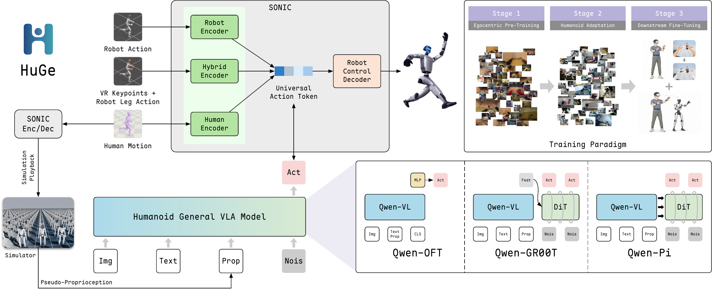

<p align="center">
  
</p>

<h1 align="center">
  HuGe: Scaling Humanoid Generalist<br>
  Vision-Language-Action Models<br>
  with Egocentric Experience
</h1>

<div align="center">

[Yang&nbsp;Liu](https://yliu-cs.github.io)<sup>&#42;</sup> · [Jiacheng&nbsp;Liu](https://jiachengliu3.github.io)<sup>&#42;</sup> · Hengtao&nbsp;Li<sup>&#42;</sup> · Yuheng&nbsp;Huang · Zijian&nbsp;Yang · Ji&nbsp;Dai<br>
Maoxin&nbsp;Wang · [Yi&nbsp;Gao](https://gaoe05.github.io) · Qishen&nbsp;Wang · Baohua&nbsp;Yin · Peiyang&nbsp;Li · [Shuanghao&nbsp;Bai](https://baishuanghao.github.io)<br>
[Mingyang&nbsp;Sun](https://sunrisulfr.github.io) · [Pengxiang&nbsp;Ding](https://dingpx.github.io) · [Jianqin&nbsp;Yin](https://teacher.bupt.edu.cn/yinjianqin/zh_CN/index.htm) · [Lixin&nbsp;Yang](https://lixiny.github.io)<sup>†</sup> · [Donglin&nbsp;Wang](https://milab.westlake.edu.cn)<sup>†</sup>

<sup>&#42; Equal contribution &nbsp; · &nbsp; † Corresponding authors</sup>

[](https://yliu-cs.github.io/HuGe/)
[](https://arxiv.org/abs/2610.34186)
[](https://github.com/yliu-cs/HuGe)
[](https://www.python.org/downloads/release/python-3120/)
[](https://pytorch.org/)

</div>

<p align="center">
  <a href="https://yliu-cs.github.io/HuGe/#overview">
    
  </a>
</p>

<p align="center">
  <em>Egocentric pre-training → Humanoid adaptation → Downstream fine-tuning.<br>
  HuGe predicts action chunks with a 66-D action at each time step.</em>
</p>

HuGe (**Hu**manoid **Ge**neralist) is a family of vision-language-action models
for humanoid whole-body control. This repository provides Qwen3-VL-2B-Instruct
implementations of OFT-, GR00T-, and Pi-style policies that predict SONIC motion
tokens and hand-control signals through a three-stage training pipeline:
egocentric pre-training, humanoid adaptation, and downstream fine-tuning.

---

## 🧩 Core contracts

| Item | Value |
| --- | --- |
| Action | 66-D: 64-D SONIC motion token + 2 binary hand states |
| Hand state | left/right; closed = 1, open = 0 |
| Proprioception | 34-D `unitree_g1_sonic v1` |
| Action horizon | 50 |
| Control rate | 50 Hz |
| Architectures | `qwenpi_v3`, `qwengr00t`, `qwenoft` |
| Base VLM | `resource/model/Qwen3-VL-2B-Instruct` |
| SONIC assets | `resource/model/sonic` |

Paper variants and configuration names:

| Paper variant | `--model-architecture` |
| --- | --- |
| HuGe-OFT | `qwenoft` |
| HuGe-GR00T | `qwengr00t` |
| HuGe-Pi | `qwenpi_v3` |

Training stages:

| Stage | Data |
| --- | --- |
| `stage1` | EgoDex, EgoVerse, BEHAVIOR-1K, and Xperience-10M |
| `stage2` | Humanoid Everyday, UniFoLM-WBT (`G1_WBT`), and HIW-500 |
| `stage3` | proprietary real/sim data or the unified HumanoidArena cache |

## ⚙️ Requirements

- Linux x86_64
- Python 3.12
- `uv`
- CUDA 12.8-compatible driver and GPU for training

The lock file pins PyTorch 2.7.1 CUDA 12.8 wheels and the Python 3.12
`flash-attn` 2.8.3 wheel.

Run all commands from the repository root.

```bash
uv sync --frozen
```

Verify the environment:

```bash
PYTHONDONTWRITEBYTECODE=1 PYTHONPATH=src .venv/bin/python - <<'PY'
import importlib.metadata as md
import torch
import huge

print("huge:", huge.__file__)
print("torch:", torch.__version__, "cuda:", torch.version.cuda)
print("flash-attn:", md.version("flash-attn"))
PY
```

Use `PYTHONPATH=src .venv/bin/python` for HuGe Python entry points. Do not
mix the root environment with the separate WBC or Isaac Lab environments.

## 🗂️ Repository layout

```text
src/huge/
  data/          datasets, schemas, preprocessing, stats, normalization
  models/        QwenSonicFM and action heads
  training/      runner, losses, checkpointing
  inference/     policy, ZMQ server, SONIC adapter, deployment logging
scripts/
  preprocess/
  train/
  eval/
configs/deepspeed/
tests/
resource/
  datasets/
  model/
.runs/
GR00T-WholeBodyControl/
HumanoidArena/
```

`GR00T-WholeBodyControl` and `HumanoidArena` are external runtime projects
with their own environments and instructions.

## 📦 Model assets

Download the local Qwen3-VL model and SONIC ONNX assets:

```bash
resource/model/hfd.sh Qwen/Qwen3-VL-2B-Instruct \
  --tool wget \
  --local-dir resource/model/Qwen3-VL-2B-Instruct

resource/model/hfd.sh nvidia/GEAR-SONIC \
  --tool wget \
  --local-dir resource/model/sonic \
  --include model_encoder.onnx model_decoder.onnx observation_config.yaml
```

The Qwen loader uses local files only.

## 🗃️ HumanoidArena data

### Required inputs

```text
resource/datasets/
  HumanoidArena_raw/
  humanoid-everyday-cache/
    g1_proprio/
  G1_WBT/
    g1_proprio/
  HIW-500/
    g1_proprio/
```

`G1_WBT` may be an external symlink.

### Download raw SONIC data

The following command downloads every top-level task's `sonic/` or
`SONIC/` subtree from `Twang2026/HumanoidArena_raw@master`:

```bash
PYTHONPATH=src .venv/bin/python - <<'PY'
from modelscope.hub.snapshot_download import dataset_snapshot_download

dataset_snapshot_download(
    dataset_id="Twang2026/HumanoidArena_raw",
    revision="master",
    local_dir="resource/datasets/HumanoidArena_raw",
    allow_patterns=["*/sonic/**", "*/SONIC/**"],
)
PY
```

This is a network and disk-intensive operation.

### Build the unified cache

```bash
PYTHONPATH=src .venv/bin/python \
  scripts/preprocess/proprietary/calc_sonic_tokens_from_humanoid_arena.py
```

Default inputs and output:

| Argument | Default |
| --- | --- |
| `--raw-root` | `resource/datasets/HumanoidArena_raw` |
| `--out-root` | `resource/datasets/HumanoidArena` |
| `--he-cache-root` | `resource/datasets/humanoid-everyday-cache` |
| `--wbt-source-root` | `resource/datasets/G1_WBT` |
| `--hiw-source-root` | `resource/datasets/HIW-500` |

The preprocessor validates all episodes, writes to staging, computes
HE + WBT + HIW + HumanoidArena union stats, validates the cache, and publishes it
atomically.

```text
resource/datasets/HumanoidArena/
  _SUCCESS
  sonic_tokens/
  g1_proprio/
  videos/chunk-000/observation.images.ego_view/
  meta/
    conversion_manifest.json
    language_map.json
    proprio_stats_union_sonic.json
```

This cache-local stats file is a legacy preprocessing output. Current training
requires cumulative statistics that also include all Stage 1 sources; generate
them as described in [Cumulative proprioception statistics](#cumulative-proprioception-statistics).

Embedded v2 RGB frames are encoded to MP4. V3 sidecar videos are linked back to
the raw tree. Do not move or delete `HumanoidArena_raw` after preprocessing.

An unchanged completed cache is reused after validation. Use `--rebuild` only
when intentionally replacing an existing cache.

## 🦿 SONIC token replay to pseudo proprio

`calc_proprio` is a file-level preprocessing tool. It does not load Dataset
classes or infer a data source from directory names. Inputs must be `[T,64]` or
`[T,66]` at 50 Hz; outputs are `[T,34] float32`.

Single file:

```bash
PYTHONPATH=src .venv/bin/python \
  scripts/preprocess/calc_proprio/run.py \
  --token /path/to/token.npy \
  --output /path/to/pseudo_proprio.npy
```

Recursive directory with mirrored output paths:

```bash
PYTHONPATH=src .venv/bin/python \
  scripts/preprocess/calc_proprio/run.py \
  --input-root /path/to/token-root \
  --output-root /path/to/proprio-root \
  --token-glob '**/*.npy' \
  --resume
```

Dataset-neutral planner trajectory preflight (the `.npz` arrays are `mode`,
`movement`, `facing`, `speed`, `height`, `vr_position`, `vr_orientation`, and
`hand_state`):

```bash
PYTHONPATH=src .venv/bin/python \
  scripts/preprocess/calc_proprio/run.py \
  --planner-trajectory /path/to/planner_trajectory.npz \
  --token-output /path/to/action_66d.npy \
  --proprio-output /path/to/proprio_34d.npy \
  --validate-only
```

Live planner mode remains in planner control, uses local SONIC encoder mode 1,
and exports the 66-D action and 34-D proprio from the same contiguous
`g1_debug` ticks. It rejects missing/duplicate ticks and does not edge-fill.

Live directory mode defaults to ten workers per visible GPU. It honors
`CUDA_VISIBLE_DEVICES` order; `--workers N` selects an explicit total and
`--workers-per-gpu N` selects a fixed per-GPU multiplier. Workers are assigned
round-robin, so worker `i` uses GPU `i % G`, replica `i // G`, ZMQ ports
`--zmq-port-base + 2*i` and `+ 2*i + 1`, and DDS Domain
`--dds-domain-base + i`. Override the bases when another process uses the
defaults.

The default of ten was selected by a 19-episode retargeted EgoVerse pilot on a
single RTX 4090. Including one same-configuration `--resume` pass, it completed
all 19 episodes in 280.330 seconds versus 1282.286 seconds for one worker, a
4.57x throughput increase. The first pass completed 16/19; all three strict
alignment failures recovered on resume. wpg11 had statistically equivalent
total time, while wpg12 and wpg13 sharply reduced first-pass success to 11/19
and 10/19, so wpg10 is the selected stability/throughput tradeoff. Use
`--workers-per-gpu 1` for a conservative node or pass another explicit value
after a target-node pilot.
BEHAVIOR planner replay remains at one worker per GPU until its separate
real-time pilot passes. GrabGPU must not run during a throughput pilot. The
measured replay utilization remained below the cluster keepalive threshold, so
production jobs still need the external keepalive policy unless the target
node pilot proves otherwise; account for its memory load separately. GPUs and
nodes sharing the same TensorRT model directory must use the same GPU model
and compatible CUDA/TensorRT runtime.

Capture, alignment and export are connected in memory. Successful and failed
default runs do not create `frames.pkl` or `aligned.npz`; add `--keep-work` only
when those debugging snapshots and per-stage logs are needed. Normal outputs
are the proprio `.npy`, its `.report.json`, and, for directory mode,
`pseudo_proprio_manifest.json` plus the append-only
`pseudo_proprio_results.jsonl`. Work files default to `.runs/calc_proprio/work`.

For 66-D input, hand proprio uses the two action-hand dimensions and is marked
`action_proxy`. For 64-D input, it keeps the simulated default hand state and
reports `input_has_no_hand_action`; this does not reconstruct human hand motion.
Warnings produce a `complete-with-warnings` batch and a zero exit code; failed
or interrupted Jobs remain nonzero.

Use `--validate-only` for a preflight that does not require a GPU,
`--resume` to revalidate and skip complete outputs, `--fail-fast` to stop after
the first failure, and optional `--stats PATH` for a distribution warning. A
live run requires the WBC `.venv_sim`, a deploy binary with `--domain-id`
support, SONIC encoder/decoder and planner assets, plus fully resolved G1 meshes
and reference-motion Git LFS files.

Stage 1 source examples, intended for four independent GPU nodes:

```bash
PYTHONPATH=src .venv/bin/python scripts/preprocess/calc_proprio/run.py \
  --input-root resource/datasets/EgoDex/episodes \
  --output-root resource/datasets/EgoDex-cache/g1_proprio \
  --token-glob '**/token_state.npy' --resume

PYTHONPATH=src .venv/bin/python scripts/preprocess/calc_proprio/run.py \
  --input-root resource/datasets/egoverse-retargeted-cache/sonic_tokens \
  --output-root resource/datasets/egoverse-retargeted-cache/g1_proprio \
  --token-glob '*.npy' --resume

PYTHONPATH=src .venv/bin/python scripts/preprocess/calc_proprio/run.py \
  --input-root resource/datasets/behavior-1k-2025-challenge-cache/sonic_tokens \
  --output-root resource/datasets/behavior-1k-2025-challenge-cache/g1_proprio \
  --token-glob '*.npy' --resume

PYTHONPATH=src .venv/bin/python scripts/preprocess/calc_proprio/run.py \
  --input-root resource/datasets/xperience-10m-cache/sonic_tokens \
  --output-root resource/datasets/xperience-10m-cache/g1_proprio \
  --token-glob '*.npy' --resume
```

The BEHAVIOR command-aware rebuild has a dedicated adapter; the default command
is read-only and does not start a GPU runtime:

```bash
PYTHONPATH=src .venv/bin/python \
  scripts/preprocess/teleop/calc_behavior1k_planner.py --preflight-only

PYTHONPATH=src .venv/bin/python \
  scripts/preprocess/teleop/calc_behavior1k_planner.py \
  --pilot --confirm-source-schema

PYTHONPATH=src .venv/bin/python \
  scripts/preprocess/teleop/calc_behavior1k_planner.py \
  --publish-full --confirm-source-schema
```

Pilot mode uses representative locomotion/trunk episodes and publishes to a
unique `/tmp` cache unless `--cache-root` is explicit. Full mode scans every
controller config, defaults to one worker per visible GPU, accepts the same
mutually exclusive `--workers`/`--workers-per-gpu` controls, and atomically
publishes:

```text
resource/datasets/behavior-1k-2025-challenge-planner-cache/
  _SUCCESS
  sonic_tokens/          # paired [T,66]
  g1_proprio/            # paired [T,34] plus per-segment reports
  meta/                  # schema, index, language, stats, manifest, execution report
```

One 30 Hz source frame remains one 50 Hz control row; base speed and yaw are
scaled by `50/30`. Movement direction and facing are world-frame unit vectors.
Stationary low-height rows use planner squat mode; when locomotion and low
height coincide, locomotion takes precedence and the conflict count is recorded
for pilot review. The current fixed-standing
`behavior-1k-2025-challenge-cache` is never overwritten. Training does not
switch to the planner cache automatically; pass the new root explicitly only
after pilot/full validation. An interrupted staging cache is retained and can
be continued with the same command plus `--resume`.

Publishing these arrays into a Stage 1 Dataset remains a separate task.

## 🏋️ Training

Training must use the launcher:

```bash
bash scripts/train/train_huge.sh <stage> [options]
```

The launcher configures Accelerate, DeepSpeed, GPU/process discovery, cuDNN,
and previous-stage checkpoint selection.

### Cumulative proprioception statistics

Prepare the source caches, paired action/proprio arrays, and dataset indexes
before training. EgoDex requires `meta/egodex_index.json`; the other Stage 1
caches require their published conversion manifests and episode indexes.
Computing stats does not build these inputs or replace the training inventory
validation.

The current trainer validates exact cumulative statistics, including the
source roots, stage scope, and 34-D layout. Even when a training example selects
a subset of episodes, its stats use the complete cumulative source pool.

| Training configuration | `--stage-scope` | Sources | File under `resource/datasets/meta/` |
| --- | --- | --- | --- |
| Stage 1 | `stage1` | EgoDex + EgoVerse + BEHAVIOR-1K + Xperience-10M | `stage1_proprio_stats_union_sonic.json` |
| Stage 2 | `stage12` | Stage 1 + HE + WBT + HIW | `stage12_proprio_stats_union_sonic.json` |
| HumanoidArena Stage 3 | `stage123_humanoid_arena` | Stage 1 + Stage 2 + all HumanoidArena tasks | `stage123_humanoid_arena_proprio_stats_union_sonic.json` |
| Real/Ego Stage 3 | `stage123_proprietary` | Stage 1 + Stage 2 + proprietary Ego + Real | `stage123_proprietary_proprio_stats_union_sonic.json` |

Run the setup and the commands for the required scopes in the same Bash
session from the repository root. Each `--source TAG=ROOT` points directly to
a directory of 34-D proprio arrays; all `*.npy` files beneath it are scanned.
The arrays must be nonempty, finite `[T,34] float32` data. The exact quantile
computation needs scratch space of at least `total_frames * 34 * 4` bytes;
its temporary subdirectory is removed when the computation finishes.

```bash
huge_data_root=resource/datasets
huge_stats_root="$huge_data_root/meta"
huge_stats_scratch=.runs/proprio_stats/scratch

stage1_sources=(
  --source "EGODEX=$huge_data_root/EgoDex-cache/g1_proprio"
  --source "EGOVERSE=$huge_data_root/egoverse-retargeted-cache/g1_proprio"
  --source "BEHAVIOR1K=$huge_data_root/behavior-1k-2025-challenge-cache/g1_proprio"
  --source "XPERIENCE=$huge_data_root/xperience-10m-cache/g1_proprio"
)
stage12_sources=(
  "${stage1_sources[@]}"
  --source "HE=$huge_data_root/humanoid-everyday-cache/g1_proprio"
  --source "WBT=$huge_data_root/G1_WBT/g1_proprio"
  --source "HIW=$huge_data_root/HIW-500/g1_proprio"
)

PYTHONPATH=src .venv/bin/python scripts/preprocess/calc_union_proprio_stats.py \
  --stage-scope stage1 "${stage1_sources[@]}" \
  --scratch-dir "$huge_stats_scratch" \
  --out "$huge_stats_root/stage1_proprio_stats_union_sonic.json" \
  --show-progress

PYTHONPATH=src .venv/bin/python scripts/preprocess/calc_union_proprio_stats.py \
  --stage-scope stage12 "${stage12_sources[@]}" \
  --scratch-dir "$huge_stats_scratch" \
  --out "$huge_stats_root/stage12_proprio_stats_union_sonic.json" \
  --show-progress

PYTHONPATH=src .venv/bin/python scripts/preprocess/calc_union_proprio_stats.py \
  --stage-scope stage123_humanoid_arena "${stage12_sources[@]}" \
  --source "HUMANOID_ARENA=$huge_data_root/HumanoidArena/g1_proprio" \
  --scratch-dir "$huge_stats_scratch" \
  --out "$huge_stats_root/stage123_humanoid_arena_proprio_stats_union_sonic.json" \
  --show-progress
```

For the Real/Ego configuration used by `scripts/train/real_huge.sh`, derive
the Ego proprio path from its existing paired index and include both
downstream sources:

```bash
huge_ego_proprio="$(
  .venv/bin/python - "$huge_data_root/proprietary/ego" <<'PY'
import json
import sys
from pathlib import Path

root = Path(sys.argv[1])
index = json.loads((root / "meta/stage3_episode_index.json").read_text())
print(root / index["cache_root"] / "g1_proprio")
PY
)"

PYTHONPATH=src .venv/bin/python scripts/preprocess/calc_union_proprio_stats.py \
  --stage-scope stage123_proprietary "${stage12_sources[@]}" \
  --source "PROP_EGO=$huge_ego_proprio" \
  --source "PROP_REAL=$huge_data_root/proprietary/real/cola_final_110/g1_proprio" \
  --scratch-dir "$huge_stats_scratch" \
  --out "$huge_stats_root/stage123_proprietary_proprio_stats_union_sonic.json" \
  --show-progress
```

HumanoidArena cumulative stats always have `task_scope="all"`. The statistics
CLI has no task selector, and current HumanoidArena training accepts only
`--humanoid-arena-task all`. Cache-local HE/WBT/HIW/HumanoidArena stats do not
satisfy this cumulative contract. Keep `--dataset-root` and any explicit source
roots consistent with the resolved source paths recorded in the stats.

### Stage 1/2 multi-source data

Repeated source arguments provide the common upper-level interface; each kind
uses its own lower-level adapter. Omitting them preserves the legacy defaults:
Stage 1 uses EgoDex only and Stage 2 uses HE + WBT.

```bash
bash scripts/train/train_huge.sh stage1 \
  --dataset-root resource/datasets \
  --stage1-source egodex resource/datasets/EgoDex \
  --stage1-source egoverse resource/datasets/egoverse-retargeted-cache \
  --stage1-source behavior1k resource/datasets/behavior-1k-2025-challenge-cache \
  --stage1-source xperience resource/datasets/xperience-10m-cache \
  --episode-fraction 0.10 \
  --episode-selection-seed 7 \
  --sample-stride 10 \
  --proprio-stats-path \
    resource/datasets/meta/stage1_proprio_stats_union_sonic.json

bash scripts/train/train_huge.sh stage2 \
  --dataset-root resource/datasets \
  --stage2-source he resource/datasets/humanoid-everyday \
  --stage2-source wbt resource/datasets/G1_WBT \
  --stage2-source hiw resource/datasets/HIW-500 \
  --proprio-stats-path \
    resource/datasets/meta/stage12_proprio_stats_union_sonic.json
```

The full-pipeline launcher now defaults Stage 1 to EgoDex + EgoVerse +
BEHAVIOR-1K + Xperience-10M and Stage 2 to Humanoid Everyday + G1_WBT +
HIW-500. Stage 1 defaults to `sample_stride=10`, and Stage 2 defaults to
`sample_stride=5`; both strides select training start frames while keeping each
50-step action target contiguous. Fractions
select a deterministic, nested subset of complete source episodes independently
of this within-episode stride. Override `--sample-stride` directly or set
`HUGE_STAGE1_SAMPLE_STRIDE` for data-volume ablations. `--max-episodes` remains
a mutually exclusive per-source prefix limit for debugging. Sources are mixed
in canonical order at their natural sample ratio.

The HIW adapter reads `HIW-500/meta/episodes` directly; when that directory is
absent, it downloads only the official `BitRobot/HIW-500-LeRobot` episode
metadata into the standard Hugging Face cache. Publish the derived 34-D state
after the in-place 66-D token upgrade:

```bash
PYTHONPATH=src .venv/bin/python \
  scripts/preprocess/hiw/prepare_hiw_cache.py --publish-source-proprio
```

The existing `resource/datasets/HIW-500-cache` still contains only `_SUCCESS`
and a validation manifest. Derived arrays live beside the source as
`HIW-500/sonic_tokens/` and `HIW-500/g1_proprio/`; videos and Parquet files are
not copied. HIW proprio uses the source 29 G1 joint positions, event-latched WBC
hand state, and projected gravity derived from WBC pivot roll/pitch/yaw. Stage 2
and Stage 3 union statistics include those valid HIW states. Head AV1 video is
decoded strictly through PyAV/libdav1d.


### HumanoidArena single configuration

```bash
bash scripts/train/train_huge.sh stage3 \
  --dataset-root resource/datasets \
  --model-architecture qwenpi_v3 \
  --init-ckpt none \
  --prop-roots \
  --humanoid-arena-roots resource/datasets/HumanoidArena \
  --humanoid-arena-task all \
  --proprio-stats-path \
    resource/datasets/meta/stage123_humanoid_arena_proprio_stats_union_sonic.json
```

The empty `--prop-roots` is intentional; it disables the default proprietary
dataset.

This trains one architecture jointly on all tasks in the unified cache.
Single-task HumanoidArena training is not supported by the current launchers.

### HumanoidArena experiment matrix

`scripts/train/run_huge.sh` defaults to three sequential Stage 3 full-tuning runs:

- task: `all`
- architectures: `qwenpi_v3 qwengr00t qwenoft`
- tuning mode: `full`
- initialization: none
- processes: 8 GPUs on one node for each full-tuning run
- training budget: 50,000 successful optimizer updates
- VLM / projector / action learning rates: `1e-5` / `2.5e-5` / `1e-4`
- periodic checkpoints: disabled; final checkpoint only

These are the current launcher defaults. Select `--full-pipeline` to run
Stage 1 -> Stage 2 -> Stage 3 for each architecture, with initialization passed
between stages. LoRA and frozen-backbone modes remain available through an
explicit `HUGE_HUMANOID_ARENA_TUNING_MODES` override.

Tuning modes:

| Mode | VLM update |
| --- | --- |
| `full` | train the full Qwen model |
| `lora` | train attention LoRA; default r=8, alpha=16, dropout=0 |
| `frozen_vlm` | freeze Qwen; train HuGe action components |

Preview one configuration without training:

```bash
tmp_dir="$(mktemp -d /tmp/huge-matrix-dry-run.XXXXXX)"

HUGE_DRY_RUN=1 \
HUGE_STAGE3_DATA=humanoid_arena \
HUGE_HUMANOID_ARENA_ARCHITECTURES=qwenpi_v3 \
HUGE_HUMANOID_ARENA_TUNING_MODES=full \
HUGE_LOCK_FILE="$tmp_dir/run.lock" \
HUGE_RUN_ROOT="$tmp_dir/runs" \
bash scripts/train/run_huge.sh
```

Run the default matrix:

```bash
bash scripts/train/run_huge.sh
```

Run one selected configuration:

```bash
bash scripts/train/run_huge.sh --arch qwenpi_v3
```

Run the three stages for one architecture:

```bash
bash scripts/train/run_huge.sh --full-pipeline --arch qwenpi_v3
```

Legacy pipeline modes:

- `HUGE_STAGE3_DATA=sim` runs Stage 1 -> Stage 2 -> sim Stage 3, using a Stage 1
  start-frame stride of 10 by default, and writes under `.runs/sim_pipeline`.
- `HUGE_STAGE3_DATA=real` runs real Stage 3 once, initializes from
  `HUGE_STAGE2_SOURCE_ROOT`, and writes under `.runs/stage3_real_cola`.

The sim pipeline uses `resource/datasets/` for Stage 1/2. Both modes retain
legacy `resource/dataset/` roots for Stage 3 and require explicit path
alignment before use.

Outputs:

```text
.runs/full_all_stage/
  all/<architecture>/<tuning-mode>/<stage>/<run-id>/
    train.log
    data_manifest.json
    training_config.json
    step_<global-step>/
      _SUCCESS
      manifest.json
      model.safetensors
      config.json
      proprio_stats_sonic.json
      proprio_norm_config.json
```

### Stage defaults

Defaults for `train_huge.sh` without experiment-specific overrides:

| Stage | LR | Batch/process | Training budget | Stride | Warmup | Weight decay | Periodic checkpoint |
| --- | ---: | ---: | ---: | ---: | ---: | ---: | --- |
| `stage1` | `3e-5` | 32 | 1 epoch | 10 | 0.05 | 0.01 | disabled |
| `stage2` | `3e-5` | 32 | 1 epoch | 5 | 0.02 | 0.01 | disabled |
| `stage3` | `3e-5` | 32 | 50,000 successful updates | 1 | 0.01 | 0.005 | disabled; final only |

When `max_steps` is set, it determines the stopping point and the epoch
setting is not used as a limit.

OFT defaults to 24 samples per process in all three stages. The experiment
launcher supplies its own grouped learning rates and other overrides; use its
dry-run output to inspect the selected configuration.

Shared defaults: `qwenpi_v3`, full Qwen training, bf16, DeepSpeed ZeRO-2,
16 action layers, 1024 action hidden size, 16 attention heads, 4 inference
steps, 4 data-loader workers, and no validation loop. Only the final checkpoint
is saved unless a periodic interval is explicitly supplied.

For explicit distributed settings:

```bash
bash scripts/train/train_huge.sh stage3 \
  --num-gpus 8 \
  --num-nodes 1 \
  --node-rank 0 \
  --master-addr 127.0.0.1 \
  --master-port 29500 \
  --init-ckpt none \
  --prop-roots /path/to/dataset \
  --proprio-stats-path /path/to/proprio_stats_union_sonic.json
```

Single-stage training retains legacy `resource/dataset/` defaults when no
explicit dataset root is passed. Use `--dataset-root resource/datasets` and
the source/stat arguments above for the current plural tree.
See [Compatibility notes](#compatibility-notes).

## 📊 Offline evaluation

`offline_compare.py` plots predicted and ground-truth actions for proprietary
datasets:

```bash
MPLCONFIGDIR=/tmp/huge-matplotlib \
HF_HUB_OFFLINE=1 \
TRANSFORMERS_OFFLINE=1 \
PYTHONPATH=src \
.venv/bin/python scripts/eval/offline_compare.py \
  --ckpt '.runs/train/stage3/<run-id>/step_*' \
  --stage stage3 \
  --prop-roots /path/to/proprietary/dataset \
  --proprio-stats-path /path/to/proprio_stats_union_sonic.json \
  --device cuda \
  --batch-size 4 \
  --sample-stride 1 \
  --chunk-keep-steps 20 \
  --episode-idx 0 \
  --out-dir .runs/eval/offline_compare
```

Base mode writes one PNG per checkpoint. Add
`--visual-ablation --visual-swap-test` to produce visual-sensitivity JSON
diagnostics.

This entry point does not expose HumanoidArena manifest/task arguments and is
not a native HumanoidArena evaluator.

## 🌐 Inference server

```bash
HF_HUB_OFFLINE=1 \
TRANSFORMERS_OFFLINE=1 \
PYTHONPATH=src \
.venv/bin/python src/huge/inference/run_huge_server.py \
  --ckpt .runs/train/stage3/<run-id>/step_<step> \
  --proprio-stats-path /path/to/proprio_stats_union_sonic.json \
  --host 127.0.0.1 \
  --port 5550 \
  --device cuda \
  --action-horizon 50 \
  --log-dir .runs/deploy_log/<run-id>
```

The server uses ZMQ REQ/REP with msgpack-numpy. It has no authentication or
TLS; do not expose it to an untrusted network.

`--log-dir` writes a JSONL manifest and per-call msgpack payloads under
`calls/`. The server first uses `--proprio-stats-path`, then a stats file
bundled in the checkpoint, then the original path in checkpoint metadata.

When the client already supplies `state.projected_gravity`, or for standalone
requests without the WBC state stream, add `--no-state-tap-enable`.

## 🦾 Deployment (real robot)

Real-robot deployment uses the independent WBC environment. Install
`GR00T-WholeBodyControl/.venv_inference` according to that project's
instructions. The commands below use the current workspace at
`/home/kinetra-5090-01/code/liuyang/Huge`, a G1 with Inspire hands, and the
QwenPI v3 full-tuning checkpoint at step 20000. Run each block in a separate
terminal. HuGe, the VLA client, WBC, and the keyboard publisher run on this
machine; the camera server must already be available at `192.168.123.164:5555`
and the robot-side Inspire DDS bridge must be running.

**Terminal 1 — HuGe policy server**

```bash
cd /home/kinetra-5090-01/code/liuyang/Huge

HUGE_DEPLOY_CKPT=".runs/finetune_real/qwenpi_v3/full/stage3/20260905_181319_qwenpi_v3_R110_E0_none/step_20000"

HF_HUB_OFFLINE=1 \
TRANSFORMERS_OFFLINE=1 \
PYTHONPATH=src \
.venv/bin/python src/huge/inference/run_huge_server.py \
--ckpt "$HUGE_DEPLOY_CKPT" \
--proprio-stats-path "$HUGE_DEPLOY_CKPT/proprio_stats_sonic.json" \
--host 0.0.0.0 \
--port 5550 \
--device cuda \
--action-horizon 50 \
--no-state-tap-enable \
--no-closed-loop-enable \
--log-dir ".runs/deploy_log/$(date +%Y%m%d_%H%M%S)"
```

This checkpoint's `config.json` sets `num_inference_steps` to `4`;
the HuGe server reads it from the checkpoint and does not expose a
`--num-inference-steps` CLI flag. Proprioception uses the stats bundled
with this exact checkpoint. The client supplies projected gravity and
publishes SONIC actions on port 5556, so both server-side state tapping
and action publishing are disabled. Bind to `0.0.0.0` only on a trusted
control network; use `127.0.0.1` to restrict access to this machine.

**Terminal 2 — GR00T WBC deploy stack**

```bash
cd /home/kinetra-5090-01/code/liuyang/Huge/GR00T-WholeBodyControl/gear_sonic_deploy

./deploy.sh --input-type zmq_manager --zmq-host localhost --hand-type inspire real
```

**Terminal 3 — VLA inference client**

Use this single client entry for the cola checkpoint above. It enables the
training hand-label compatibility fix and records request, response, action
publication, camera-read, and keyboard timing. It reuses the original
asynchronous client loop and starts paused. Run only one VLA client.

```bash
cd /home/kinetra-5090-01/code/liuyang/Huge
HUGE_TRACE_DIR=".runs/deploy_timing/$(date +%Y%m%d_%H%M%S_%N)"
env -u PYTHONPATH -u LD_LIBRARY_PATH PYTHONDONTWRITEBYTECODE=1 \
GR00T-WholeBodyControl/.venv_inference/bin/python \
scripts/eval/run_traced_vla_inference.py \
--trace-dir "$HUGE_TRACE_DIR" \
--hand-state-compat legacy-inspire-six-channel \
--debug-save-hand-dir "$HUGE_TRACE_DIR" \
--host localhost \
--port 5550 \
--embodiment-tag unitree_g1_sonic \
--hand-type inspire \
--prompt "Walk forward, grab the cola and throw into the trash bin" \
--action-publish-rate 50 \
--action-horizon 50 \
--rate 2.5 \
--camera-host 192.168.123.164 \
--camera-port 5555
```

The client uses its Python 3.10 environment directly. Removing inherited
`PYTHONPATH` and `LD_LIBRARY_PATH` prevents ROS Python 3.12 packages and shared
libraries from overriding its Pinocchio dependencies.

Hand debug captures are saved under `$HUGE_TRACE_DIR/hand_debug_<timestamp>/`.
By default, each published action frame writes `.npz` and `.json` files with
the hand targets sent by the client and the available WBC hand feedback.

`--rate 2.5` inserts a 0.4-second wait after each completed inference; the
actual chunk update interval also includes inference latency. Actions are
published at 50 Hz. The client repeats the last action when a chunk expires.
The wrapper records local PUB sends, which do not confirm WBC receipt or
execution. Timing adds CPU and disk overhead; actual deployment overhead has
not been measured.

After the client exits, summarize the recording in the same terminal:

```bash
env -u PYTHONPATH -u LD_LIBRARY_PATH PYTHONDONTWRITEBYTECODE=1 \
GR00T-WholeBodyControl/.venv_inference/bin/python \
scripts/eval/summarize_vla_timing.py --trace-dir "$HUGE_TRACE_DIR"
```

The run directory contains `metadata.json` and `events.jsonl`; the summary
command writes `summary.json` and `summary.md`, including hand-label audit
completeness. See the [timing document](resource/info/vla_client_timing_trace_plan.md)
and [hand-state compatibility document](resource/info/legacy_inspire_hand_state_compat_plan.md)
for detailed diagnostics and validation scope.

**Terminal 4 — Keyboard publisher**

```bash
cd /home/kinetra-5090-01/code/liuyang/Huge/GR00T-WholeBodyControl

env -u PYTHONPATH -u LD_LIBRARY_PATH \
.venv_inference/bin/python keyboard_pub.py
```

The deploy process controls physical hardware and requires operator checks.
Confirm deployment manually in Terminal 2. The VLA client starts paused.
In Terminal 4, type each key and press Enter: `k` starts the WBC control loop
in planner mode, `i` sends the initial pose and switches to pose mode, and `p`
resumes action publishing. The initial pose token must match the SONIC model
used for data collection and deployment.

`p` pauses client publishing while WBC continues running; `k` sends the WBC
stop command. Exiting the client with Ctrl+C does not send that stop command.
Do not automate confirmation or motor enablement. Action validity and sensor
freshness handling must be verified before physical deployment.

## 🧪 HumanoidArena simulation evaluation

The evaluator loads native HuGe portable checkpoints and runs the SONIC
backend. It uses the root `.venv` for orchestration and policy inference,
and HumanoidArena's dedicated Isaac Lab interpreter for simulation. Prepare
the repository-local `HumanoidArena/` runtime, its task configurations, and
the required SONIC and local Qwen assets before using this entry point.
`env.sh` resolves the simulation interpreter through HumanoidArena's
`isaaclab_twist2_g1/script/common/runtime_paths.sh`.

```bash
bash scripts/eval/humanoidarena/run_eval.sh \
  <task> <checkpoint_dir_or_root> [sonic]
```

Pass a published `step_<N>` directory to evaluate one checkpoint, or a parent
directory to discover published `step_<N>` directories recursively. Discovery
orders checkpoints by parent path and then numeric step; it evaluates every
discovered checkpoint. Each checkpoint must include `config.json`,
`model.safetensors`, `proprio_stats_sonic.json`, `proprio_norm_config.json`,
`manifest.json`, and `_SUCCESS`, with valid publication metadata. The local
Qwen path recorded in the checkpoint must resolve on this machine.

Supported task names are `boxing`, `doubledesk`, `football`, `open_door`,
`pp_box`, `sit_sofa`, and `vision_navi`. Use `all` as the **task** to evaluate
all seven tasks for each selected checkpoint. The backend is always `sonic`;
LeRobot `pretrained_model` directories and the `twist2` backend are not
accepted by this launcher.

Preview one checkpoint and one episode without starting policy inference or
simulation. Replace the checkpoint path with an existing published directory:

```bash
HUGE_EVAL_CKPT=/absolute/path/to/step_20000

HUGE_EVAL_DRY_RUN=1 \
TEST_MODE=base_test \
SEEDS_OVERRIDE=0 \
REPEATS_PER_SEED=1 \
HUGE_EVAL_GPU_COUNT=1 \
HUGE_EVAL_WORKERS_PER_GPU=1 \
bash scripts/eval/humanoidarena/run_eval.sh \
  pp_box "$HUGE_EVAL_CKPT" sonic
```

For this single-checkpoint, single-task invocation, dry-run prints a JSON
static plan to stdout. It validates the checkpoint, local model assets,
task YAML, and required upstream source interfaces using the Isaac Lab
interpreter. It stops before CUDA discovery, model loading, network sockets,
or simulation startup, so an available GPU is not required for this check.
The installed Python environments and runtime files are still required.
It does not create an evaluation attempt or save `plan.json`. A dry-run using
a checkpoint root or the `all` task goes through the batch wrapper, which
also writes batch logs and summaries.

Run a one-checkpoint, one-episode smoke evaluation on one visible GPU,
using `HUGE_EVAL_CKPT` from the preceding block:

```bash
HUGE_EVAL_DRY_RUN=0 \
TEST_MODE=base_test \
SEEDS_OVERRIDE=0 \
REPEATS_PER_SEED=1 \
HUGE_EVAL_GPU_COUNT=1 \
HUGE_EVAL_WORKERS_PER_GPU=1 \
HUGE_EVAL_OUTPUT_ROOT=.runs/eval/humanoidarena_smoke \
bash scripts/eval/humanoidarena/run_eval.sh \
  pp_box "$HUGE_EVAL_CKPT" sonic
```

This command starts the HuGe policy server and Isaac Lab simulation. Before
launch, the shell preflight checks OpenGL libraries, TensorRT, cuDNN, and
ONNX Runtime CUDA support. `SKIP_PREFLIGHT=1` permits execution after those
shell checks fail; it does not disable later validation or make the run a
dry-run.

Evaluate all seven tasks with three seed groups and 20 episodes per group
(420 episodes per selected checkpoint):

```bash
HUGE_EVAL_DRY_RUN=0 \
TEST_MODE=base_test \
SEEDS_OVERRIDE=0,1,2 \
REPEATS_PER_SEED=20 \
HUGE_EVAL_GPU_COUNT=1 \
HUGE_EVAL_WORKERS_PER_GPU=1 \
HUGE_EVAL_OUTPUT_ROOT=.runs/eval/humanoidarena \
bash scripts/eval/humanoidarena/run_eval.sh \
  all "$HUGE_EVAL_CKPT" sonic
```

Checkpoint and task batches run serially; episodes within a task use the
selected GPU workers. Passing a checkpoint parent directory expands this
evaluation to every discovered checkpoint. Use a checkpoint trained for the
intended tasks.

Common environment overrides:

| Variable | Behavior |
| --- | --- |
| `TEST_MODE` | Task YAML configuration directory; default `base_test`. |
| `SEEDS_OVERRIDE`, `REPEATS_PER_SEED` | Override the seed groups and repeats from the task YAML. |
| `MAX_STEPS` | Override the task-specific episode step limit. |
| `HUGE_EVAL_GPU_COUNT` | Use the first N CUDA-visible GPUs; mutually exclusive with `HUGE_EVAL_GPU_LOGICAL_IDS`. |
| `HUGE_EVAL_GPU_LOGICAL_IDS` | Comma-separated CUDA logical IDs, respecting `CUDA_VISIBLE_DEVICES`. If neither GPU selector is set, all visible GPUs are selected. |
| `HUGE_EVAL_WORKERS_PER_GPU` | `1` or `2`; the shell launcher defaults to `2`. |
| `HUGE_EVAL_EXECUTION_HORIZON` | Actions executed from each 50-step prediction; default `20`, range `1..50`. |
| `HUGE_EVAL_OUTPUT_ROOT` | Episode-result root; default `.runs/eval/humanoidarena`. Must resolve inside this repository's `.runs/`. |
| `HUGE_EVAL_RESUME` | Default `1`; reuse compatible completed work. |
| `HUGE_EVAL_RECORD_VIDEO_EVERY_N` | Video recording interval; `0` disables recording. |
| `HUGE_EVAL_DRY_RUN` | `1` performs static validation and prints the plan; default `0`. |

The launcher does not use the legacy `DRY_RUN`, `NUM_WORKERS`, `MODEL_LIMIT`,
or `MODEL_PATHS_CSV` variables. The numeric `<index> 2` interface is a separate,
historical P&PBox checkpoint matrix with fixed defaults; use the task-based
interface shown here for new runs.

Actual evaluation writes plans, logs, episode records, and summaries:

```text
<HUGE_EVAL_OUTPUT_ROOT>/<task>/<checkpoint-label>/<contract-id>/
  contract.json
  attempts/<attempt-id>/
    plan.json
    summary.json
    summary.csv
    ...
```

Checkpoint-root and `all` invocations additionally write batch progress and
logs under `.runs/eval/humanoidarena_batch/<task>/<run-id>/`, independently of
`HUGE_EVAL_OUTPUT_ROOT`. Each task summary reports successful and completed
episode counts, including per-seed counts.

## ✅ Validation

HumanoidArena preprocessing tests:

```bash
PYTHONDONTWRITEBYTECODE=1 PYTHONPATH=src \
.venv/bin/python -m unittest discover -s tests \
  -p 'test_humanoid_arena_preprocess_*.py' -v
```

Python syntax:

```bash
PYTHONPYCACHEPREFIX=/tmp/huge-readme-pycache \
.venv/bin/python -m compileall -q src scripts tests
```

Shell syntax:

```bash
find scripts -type f -name '*.sh' -print0 | xargs -0 -n1 bash -n
```

## ⚠️ Compatibility notes

- Current data is stored under `resource/datasets/`. Single-stage training,
  the general audit, and several legacy sim/real/preprocessing defaults still
  use `resource/dataset/`. Pass explicit roots as shown above.
- Stage 1 accepts `--egodex-root resource/datasets/EgoDex`; both Stage 1 and
  Stage 2 accept repeated typed source arguments for the plural tree. Their
  cumulative stats still require all sources in the corresponding stage scope.
- HumanoidArena training accepts only `all` and requires
  `stage123_humanoid_arena_proprio_stats_union_sonic.json`. The cache-local
  `HumanoidArena/meta/proprio_stats_union_sonic.json` is a preprocessing output
  and does not satisfy the cumulative training contract.
- `scripts/download_humanoidarena_vision_navi.py` is not present. The
  ModelScope snippet above is the supported download command in this README.
- `tests/test_download_humanoidarena_vision_navi.py` still imports the removed
  downloader module; restore or remove that stale test before using full
  `test_*.py` discovery as a green check.
- `src/huge/data/audit.py` writes a report and still checks legacy singular
  paths; it is not a complete audit of the unified HumanoidArena cache.
- `offline_compare.py` is not a native HumanoidArena evaluator.
- The HumanoidArena evaluator loads native HuGe published `step_<N>`
  checkpoints and supports the SONIC backend. `all` selects seven tasks.

## 🙏 Acknowledgments

HuGe builds on Psi0, GR00T-WholeBodyControl, Isaac-GR00T, GEAR-SONIC,
HumanoidArena, and Qwen3-VL.

## 📖 Citation

If HuGe supports your research, please consider citing our
[paper](https://arxiv.org/abs/2610.34186):

```bibtex
@article{liu2026huge,
  author    = {Yang Liu and Jiacheng Liu and Hengtao Li and Yuheng Huang and Zijian Yang and Ji Dai and Maoxin Wang and Yi Gao and Qishen Wang and Baohua Yin and Peiyang Li and Shuanghao Bai and Mingyang Sun and Pengxiang Ding and Jianqin Yin and Lixin Yang and Donglin Wang},
  title     = {{HuGe}: Scaling Humanoid Generalist Vision-Language-Action Models with Egocentric Experience},
  journal   = {CoRR},
  volume    = {abs/2610.34186},
  year      = {2026},
  url       = {https://arxiv.org/abs/2610.34186}
}
```
